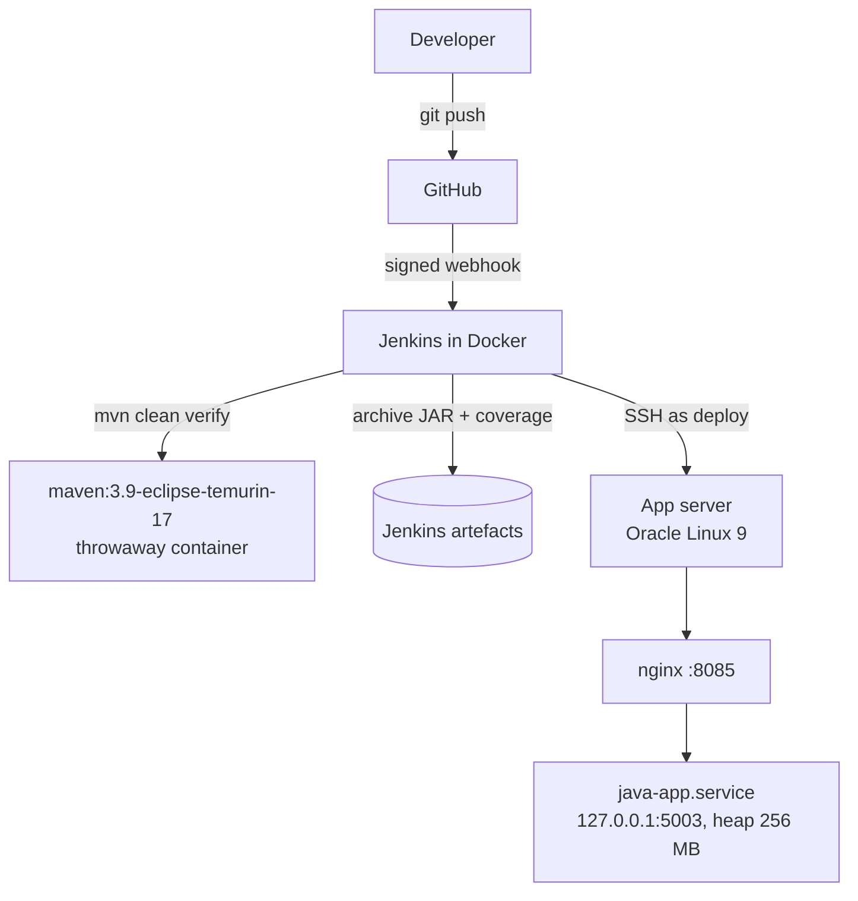

# jenkins-java-app-pipeline

Java 17 CI/CD on Oracle Cloud Infrastructure. A push to `main` triggers Jenkins through a GitHub
webhook. Maven compiles, tests and measures coverage inside a throwaway build container; the
versioned JAR is archived in Jenkins, checksum-verified on the app server, started under systemd
and health-checked through nginx. An unhealthy release is rolled back automatically.

Lab 3 of a series of CI/CD labs on OCI (GitHub · Jenkins · Docker · Oracle Linux app server).
Builds on [Lab 1](https://github.com/abdulzaferdevops/jenkins-static-site-deploy) and
[Lab 2](https://github.com/abdulzaferdevops/jenkins-flask-api-pipeline).

## Architecture



## The service

A small FX quote API using only the JDK (built-in HTTP server, `BigDecimal` with banker's
rounding). The deployable is a single ~12 KB JAR with no runtime dependencies.
Rates are **fixed demo values**, not live market data.

| Endpoint | Returns |
|:--|:--|
| `GET /health` | `status`, `release`, `commit`, `built`; used by the pipeline to confirm the live build |
| `GET /api/rates` | Demo reference rates (USD base; OMR, AED, SAR, QAR, BHD, KWD, EUR, GBP) |
| `GET /api/convert?from=OMR&to=USD&amount=100` | Converted amount to 4 decimal places |

Errors are JSON with the right status: `400` for bad input, `404` for unknown paths, `405` for non-GET.

## Pipeline

| Stage | What it does |
|:--|:--|
| Preflight | Checks `APP_HOST`, Docker access and the SSH connection; names the release `<build>-<commit>` |
| Build & test | `mvn clean verify` in a throwaway container: compiles with warnings as errors, runs JUnit 5, enforces **≥ 70 % line coverage** (JaCoCo) |
| Archive | Keeps the JAR (fingerprinted) and the coverage report as Jenkins artefacts |
| Package | JAR plus a `RELEASE` file recording build, commit and **SHA-256** |
| Deploy | Verifies the checksum, switches `current`, restarts the service, checks `/health` |
| Smoke test | Calls a real conversion through nginx |
| Rollback | Manual: `ACTION=rollback` returns to the previous **healthy** release |

### Failure handling

| Failure | Outcome |
|:--|:--|
| Compile warning, failing test or coverage below the gate | Nothing is deployed |
| JAR changed after the build (checksum mismatch) | Release discarded; live service untouched |
| Service won't start, or `/health` reports the wrong release | Previous release restored automatically; build marked failed |

## Running alongside other services

The app server also runs an older Java service and Labs 1–2. This service is sized to share it:
heap capped at 256 MB, the whole unit at 384 MB (`MemoryMax`), and it uses about 50 MB in practice.

## Security choices

- Runs as the unprivileged `deploy` user with `NoNewPrivileges` and a private `/tmp`; listens on localhost only.
- The deploy user's sudo rule allows **only** restarting and inspecting `java-app.service`.
- Build runs in a throwaway container as the Jenkins user, not as root.
- The deploy key works only from the lab subnet; the host key is pinned (see Lab 1).
- No secrets or server addresses in the repo.

## Build locally

```bash
mvn clean verify                      # tests + coverage report in target/site/jacoco
java -jar target/fx-rates-service.jar # http://127.0.0.1:5003/health
```

## Licence

MIT
